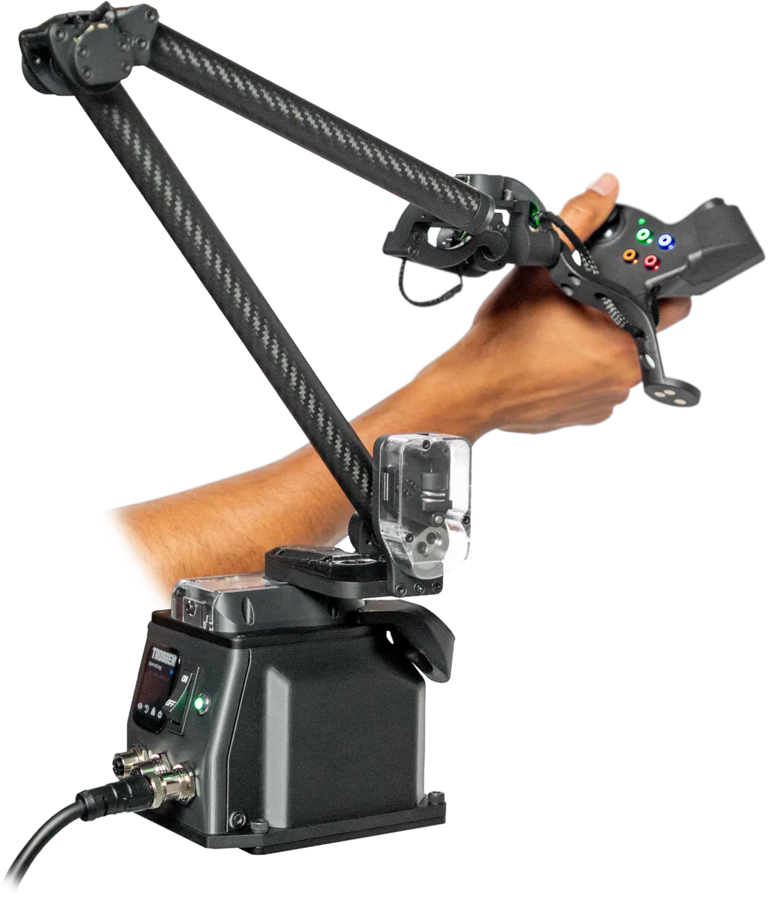

====
Arms
====

.. attention::

  Specifications on this page are preliminary and subject to change.

WidowX Arms
===========

The WidowX Core, Pro, and Heavy use the same joint layout, end effector, and controller base but differ in joint effort, payload, and reach.

.. list-table::
    :align: center

    * - .. image:: images/wxcore_hero.webp
              :align: center
              :alt: WidowX Core arm
              :width: 250px

      - .. image:: images/wxpro_hero.webp
              :align: center
              :alt: WidowX Pro arm
              :width: 250px

      - .. image:: images/wxheavy_hero.webp
              :align: center
              :alt: WidowX Heavy arm
              :width: 270px

    * - :doc:`Core <wxcore>`
      - :doc:`Pro <wxpro>`
      - :doc:`Heavy <wxheavy>`

.. table::
    :align: center
    :class: spec-merged

    +--------------------+-------------+-------------+-------------+
    | Specification      | Core        | Pro         | Heavy       |
    +====================+=============+=============+=============+
    | Degrees of Freedom | 6 + Gripper                             |
    +--------------------+-------------+-------------+-------------+
    | Payload Capacity   | 2 kg        | 4 kg        | 6 kg        |
    +--------------------+-------------+-------------+-------------+
    | Weight             | 5.5 kg      | 6 kg        | 8 kg        |
    +--------------------+-------------+-------------+-------------+
    | Reach              | 0.790 m                   | 1.114 m     |
    +--------------------+-------------+-------------+-------------+
    | Gripper Stroke     | 90 mm                                   |
    +--------------------+-------------+-------------+-------------+
    | Nominal Voltage    | 24 V                                    |
    +--------------------+-------------+-------------+-------------+
    | Peak Current       | 15 A                      | TBD         |
    +--------------------+-------------+-------------+-------------+
    | Communication      | Ethernet                                |
    +--------------------+-------------+-------------+-------------+

Glide
=====

The :doc:`Glide <glide>` is a passive teleoperation device that an operator moves to control a follower arm.
The handle has a trigger, buttons, a joystick, and a vibration motor for haptic feedback.

WidowX AI
=========

The :doc:`WidowX AI <wxai>` is the previous-generation arm.
Its specifications are kept for reference.

.. toctree::
    :hidden:

    wxcore.rst
    wxpro.rst
    wxheavy.rst
    glide.rst
    wxai.rst
