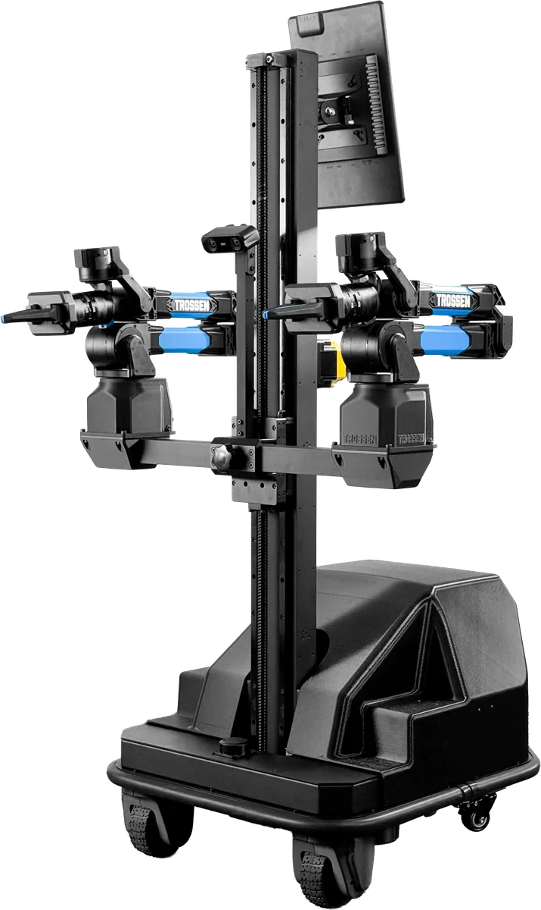
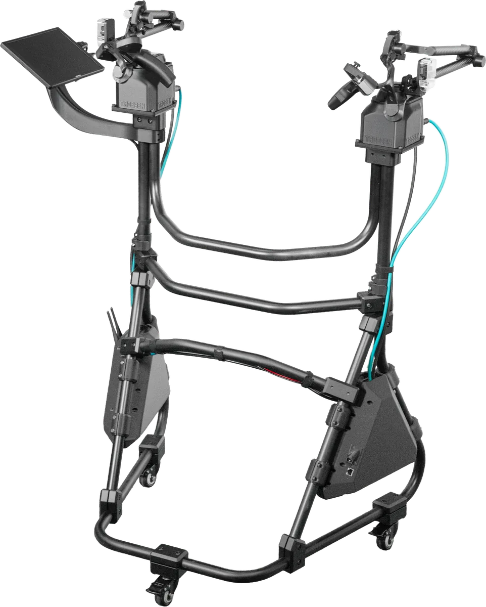
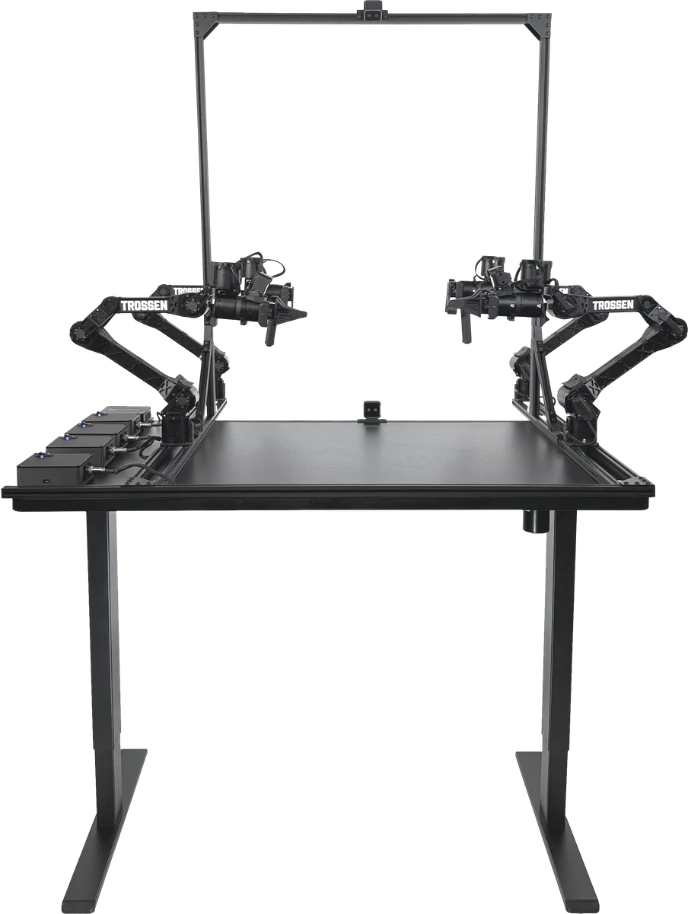
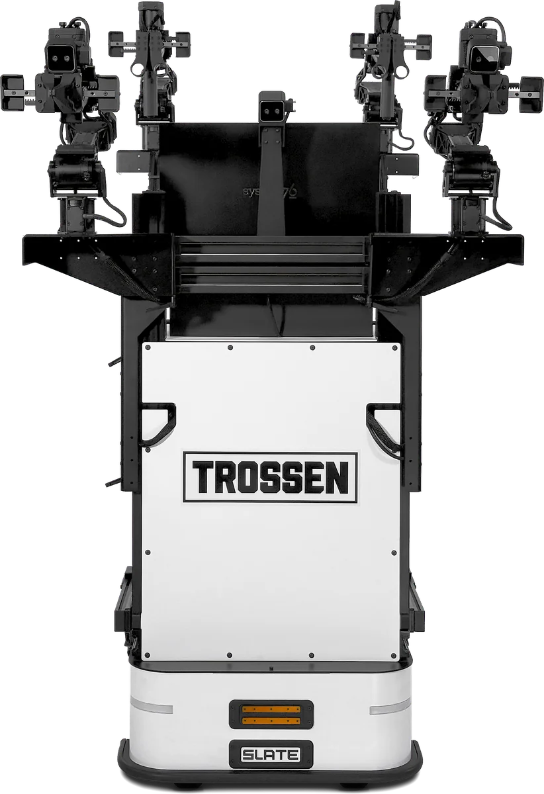

=======
Systems
=======

Rivet
=====

The :doc:`Rivet <rivet>` is a mobile system with two WidowX arms on a lift, a three-wheel swerve base, and an onboard computer.

Cockpit
=======

The :doc:`Cockpit <cockpit>` is a rolling teleoperation stand that holds two Glides.

Stationary AI Kit
=================

The :doc:`Stationary AI Kit <stationary_ai>` is a previous-generation kit.
Its specifications are kept for reference.

Mobile AI Kit
=============

The :doc:`Mobile AI Kit <mobile_ai>` is a previous-generation kit.
Its specifications are kept for reference.

.. toctree::
    :hidden:

    rivet.rst
    cockpit.rst
    stationary_ai.rst
    mobile_ai.rst
